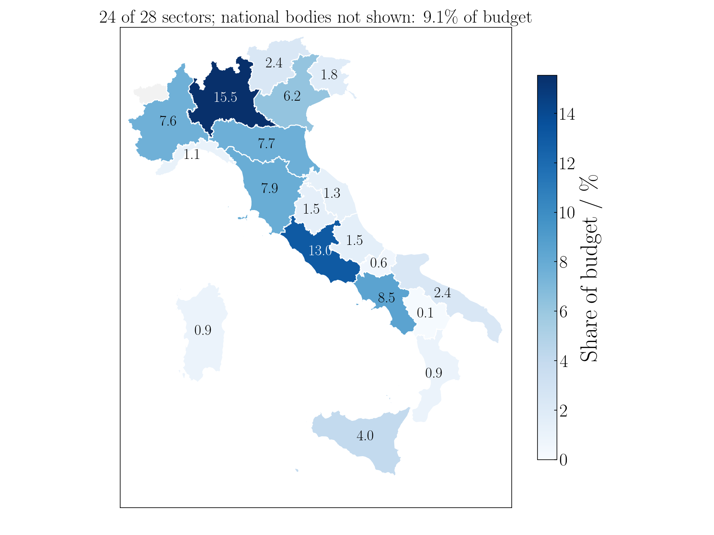
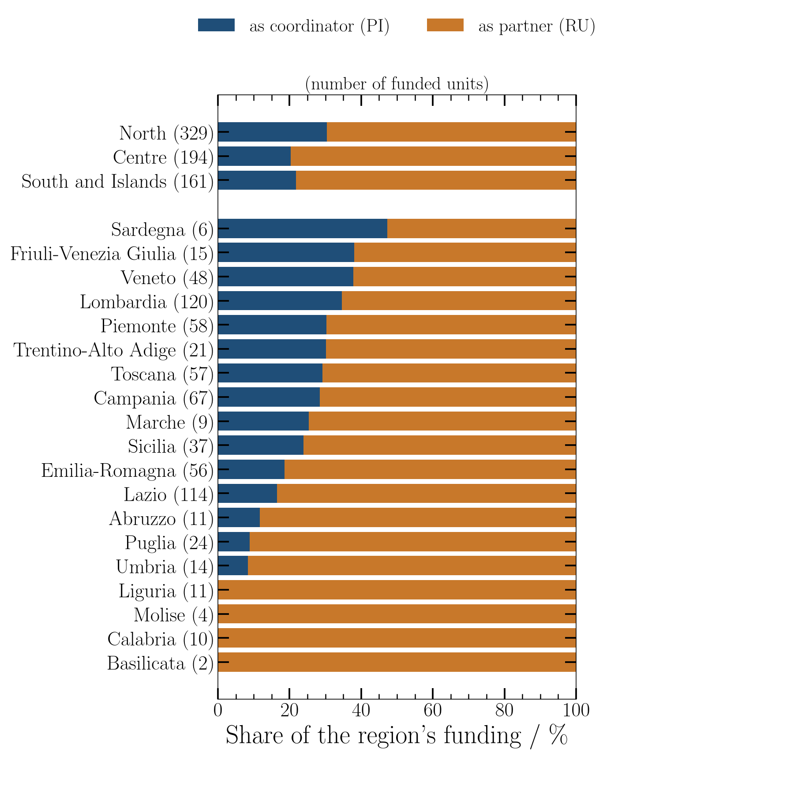
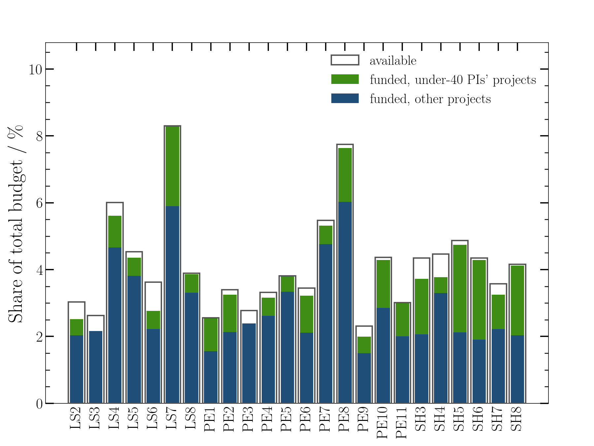
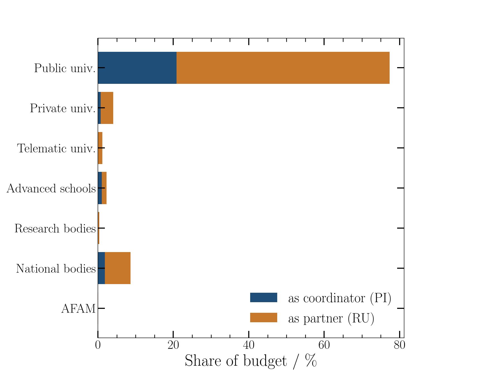
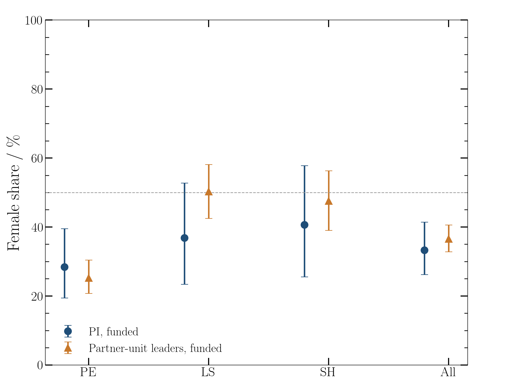

# prin-extract

Turns the official results of the Italian **PRIN 2026** call into searchable tables, and analyses who received the money: by sector, region, institution type, project role, PI age group and gender of the unit leaders.

The MUR (Ministry of University and Research) publishes the results as one decree per ERC sector (PE = Physical Sciences and Engineering, LS = Life Sciences, SH = Social Sciences and Humanities), each with three PDFs: the decree with the funds of the sector, the ranking of the projects judged fundable (Tabella A), and the funded projects (Tabella B). A funded project spans several rows (the coordinating unit and its partner units) and its title sits apart from them, so the PDFs cannot be searched or summed directly. This tool reads them into flat tables, one row per research unit.

Source: <https://prin.mur.gov.it/Pages/Index/301>. Sectors are published one after the other, so every result below is provisional.

## Install

```
pip install requests beautifulsoup4 pypdf openpyxl pandas numpy scipy matplotlib
```

Optional: a LaTeX installation (figures use LaTeX text; `analysis.py --no-latex` falls back on matplotlib's own) and `pdflatex` for the report.

## Which command do I need?

| I want | Run | Needs | Writes |
|---|---|---|---|
| The tables of all funded units and of the ranking | `python3 prin_extract.py --csv` | network, or the PDFs already in `prin_pdfs/` with `--no-download` | `prin_out/all_rows.csv`, `ranking.csv`, `decrees.json`, the Excel file, the sector table below |
| The projects of one or more institutions | `python3 prin_extract.py --uni 80002070524 --csv` | same | one CSV and one Excel sheet per `--uni` |
| Tables and figures of the analysis | `python3 analysis.py` | the output of `prin_extract.py --csv` | `prin_out/analysis/*.csv`, `prin_out/figures/*.{pdf,png}` |
| The PDF report | `python3 report.py` | the output of `analysis.py`, `pdflatex` | `report/report.pdf`, the results block below |

`--uni` takes a case-insensitive substring of the institution name or an 11-digit tax code (codice fiscale), matched exactly. Prefer the tax code: `MILANO` also matches Politecnico and Bicocca, whereas `80012650158` is only Statale. `analysis.py` and `report.py` take `--highlight CITY` (default Siena) to colour one city on the maps and to write an institution fact sheet in the report; `report.py --no-compile` writes the LaTeX source only.

## Automatic updates

[.github/workflows/check-new-sectors.yml](.github/workflows/check-new-sectors.yml) runs every 6 hours (and on demand from the Actions tab) until all 28 sectors are parsed. It runs `prin_extract.py`; if a sector is new or a decree changed, it installs LaTeX, regenerates all tables, figures and the report with `analysis.py` and `report.py`, runs the tests, and opens a pull request with the new PDFs, tables, figures, report and README, listing the new sectors and whether the tests and the analysis passed. Nothing is committed to the default branch. When all 28 sectors are in `prin_out/all_rows.csv` the workflow disables itself. `analysis.py` also appends the shares of institutions and regions to `prin_out/history.csv` whenever the set of parsed sectors changes, so the numbers can be followed as sectors are published.

## Sectors

Each sector has its own decree, which gives the funds available to the sector, split into the ring-fenced under-40 pool and the ordinary pool. A decree can be annulled and replaced (PE7: n. 32, replaced by n. 45); only the current one is listed. Sectors that are not parsed are not in any table. The table is rewritten by `prin_extract.py`.

<!-- sectors:begin -->
18 of 28 sectors parsed.

| Sector | Status | Decree | Budget (M EUR) | Funded (M EUR) | Projects |
|---|---|---|---:|---:|---:|
| PE1 | parsed | [n. 29 of 05/10/2026](https://www.mur.gov.it/it/atti-e-normativa/decreto-direttoriale-n29-del-05-10-2026) | 5.52 | 5.52 | 5 |
| PE2 | parsed | [n. 30 of 05/10/2026](https://www.mur.gov.it/it/atti-e-normativa/decreto-direttoriale-n-30-del-05-10-2026) | 7.32 | 6.99 | 6 |
| PE3 | parsed | [n. 31 of 05/10/2026](https://www.mur.gov.it/it/atti-e-normativa/decreto-direttoriale-n31-del-05-10-2026) | 5.98 | 5.14 | 5 |
| PE4 | not yet published | | 7.15 | | |
| PE5 | parsed | [n. 47 of 08/10/2026](https://www.mur.gov.it/it/atti-e-normativa/decreto-direttoriale-n47-del-08-10-2026) | 8.22 | 8.22 | 8 |
| PE6 | parsed | [n. 48 of 08/10/2026](https://www.mur.gov.it/it/atti-e-normativa/decreto-direttoriale-n-48-del-08-10-2026) | 7.42 | 6.95 | 6 |
| PE7 | parsed | [n. 45 of 06/10/2026](https://www.mur.gov.it/it/atti-e-normativa/bando-prin-2026-ddg-6-ottobre-2026-n-45-macrosettore-pe-settore-pe7-approvazione) | 11.79 | 11.45 | 11 |
| PE8 | parsed | [n. 33 of 05/10/2026](https://www.mur.gov.it/it/atti-e-normativa/decreto-direttoriale-n33-del-05-10-2026) | 16.69 | 16.46 | 14 |
| PE9 | parsed | [n. 34 of 05/10/2026](https://www.mur.gov.it/it/atti-e-normativa/decreto-direttoriale-n34-del-05-10-2026) | 4.97 | 4.29 | 4 |
| PE10 | parsed | [n. 35 of 05/10/2026](https://www.mur.gov.it/it/atti-e-normativa/decreto-direttoriale-n35-del-05-10-2026) | 9.41 | 9.24 | 9 |
| PE11 | parsed | [n. 36 of 05/10/2026](https://www.mur.gov.it/it/atti-e-normativa/decreto-direttoriale-n36-del-05-10-2026) | 6.49 | 6.49 | 6 |
| LS1 | not yet published | | 6.88 | | |
| LS2 | parsed | [n. 37 of 06/10/2026](https://www.mur.gov.it/it/atti-e-normativa/bando-prin-2026-ddg-6-ottobre-2026-n-37-macrosettore-ls-settore-ls2-approvazione) | 6.53 | 5.43 | 5 |
| LS3 | parsed | [n. 38 of 06/10/2026](https://www.mur.gov.it/it/atti-e-normativa/bando-prin-2026-ddg-6-ottobre-2026-n-38-macrosettore-ls-settore-ls3-approvazione) | 5.66 | 4.67 | 4 |
| LS4 | parsed | [n. 42 of 06/10/2026](https://www.mur.gov.it/it/atti-e-normativa/bando-prin-2026-ddg-6-ottobre-2026-n-42-macrosettore-ls-settore-ls4-approvazione) | 12.94 | 12.09 | 12 |
| LS5 | not yet published | | 9.77 | | |
| LS6 | not yet published | | 7.81 | | |
| LS7 | parsed | [n. 39 of 06/10/2026](https://www.mur.gov.it/it/atti-e-normativa/bando-prin-2026-ddg-6-ottobre-2026-n-39-macrosettore-ls-settore-ls7-approvazione) | 17.88 | 17.88 | 17 |
| LS8 | not yet published | | 8.39 | | |
| LS9 | not yet published | | 15.11 | | |
| SH1 | not yet published | | 10.58 | | |
| SH2 | not yet published | | 11.87 | | |
| SH3 | not yet published | | 9.36 | | |
| SH4 | parsed | [n. 40 of 06/10/2026](https://www.mur.gov.it/it/atti-e-normativa/bando-prin-2026-ddg-6-ottobre-2026-n-40-macrosettore-sh-settore-sh4-approvazione) | 9.62 | 8.12 | 8 |
| SH5 | parsed | [n. 41 of 06/10/2026](https://www.mur.gov.it/it/atti-e-normativa/bando-prin-2026-ddg-6-ottobre-2026-n-41-macrosettore-sh-settore-sh5-approvazione) | 10.50 | 10.22 | 9 |
| SH6 | parsed | [n. 44 of 06/10/2026](https://www.mur.gov.it/it/atti-e-normativa/bando-prin-2026-ddg-6-ottobre-2026-n-44-macrosettore-sh-settore-sh6-approvazione) | 9.37 | 9.25 | 9 |
| SH7 | parsed | [n. 49 of 09/10/2026](https://www.mur.gov.it/it/atti-e-normativa/decreto-direttoriale-n-49-del-09-10-2026) | 7.70 | 7.00 | 6 |
| SH8 | not yet published | | 8.96 | | |
<!-- sectors:end -->

## Results

<!-- results:begin -->
Provisional: 18 of 28 sectors. Regenerate with `python3 analysis.py` and `python3 report.py`; the full report is [report/report.pdf](report/report.pdf).

| Quantity | Value |
|---|---|
| Budget of the parsed sectors | 164.01 M EUR |
| Funded | 155.40 M EUR (94.8% of the budget) |
| Projects, units | 144, 726 (144 PI, 582 RU) |
| Institutions with a funded unit | 84 |
| Share by institution type | Public univ. 76.9%, Private univ. 3.9%, Telematic univ. 1.3%, Advanced schools 2.7%, Research bodies 0.5%, National bodies 9.4%, AFAM 0.1% |
| Share by macro-area | North 41.8% (of which 30% as PI), Centre 23.4% (of which 21% as PI), South and Islands 20.2% (of which 24% as PI); national research bodies 9.4% |
| Median MUR contribution per unit | 258 k EUR (PI), 193 k EUR (RU) |
| Projects of under-40 PIs | 37 projects, 40.11 M EUR (25.8% of the funded money); under-40 pools 24.32 M EUR |
| Women among unit leaders | 33% of PIs, 37% of partner-unit leaders |


*Share of the total budget by region (national research bodies not shown).*


*Per macro-area and region, share of the funding received as coordinating (PI) and partner (RU) units.*


*Per sector, in percent of the total budget: budget available and money funded, with the projects of under-40 PIs in green.*


*Share of the total budget by institution type.*


*Share of women among unit leaders, with 95% intervals.*
<!-- results:end -->

## What the analysis computes

| Output | Question it answers |
|---|---|
| Share of the budget by sector, with the under-40 PIs' projects | How the funded money compares with the budget of each sector |
| Share by institution type, region, macro-area | Where the money went |
| PI and RU split by region | Which part of a region's money came from coordinating and which from partner units |
| Money per unit | The distribution of the contribution to a single unit |
| Gender of unit leaders | The share of women among PIs and partner-unit leaders, with Wilson 95% intervals |
| Per-institution tables, collaboration graph, breadth | In `prin_out/analysis/` and the report: ranks, shared projects between cities, sectors per institution |

Definitions: the *budget* is the sum, over the parsed sectors, of the funds the decrees make available (under-40 pool plus ordinary pool); a *share* is the MUR contribution divided by that budget; a project's money is the sum of its units' contributions. National research bodies (CNR, INAF, INFN, INGV) are multi-site and have no region, so they are a separate bucket in the regional tables and are left off the maps.

## Hand-made tables in `data/`

| File | Content | When to edit |
|---|---|---|
| `institutions.csv` | tax code, short name, city, region, coordinates, type of each institution | when a new sector brings an institution not listed: `analysis.py` stops with its name |
| `given_names.csv` | first given name, gender (F or M), and whether it was assigned by hand or by the Italian ending rule | `analysis.py` logs a warning with the names it does not find; a missing name falls back on the ending rule |
| `italy_regions.geojson` | simplified region boundaries (ISTAT administrative boundaries, via the openpolis/geojson-italy repository) | never |

Gender is inferred from the first given name only, is binary, and is meant for aggregate use.

## Output columns

`all_rows.csv`, one row per funded unit: `sector`, `project_code`, `title`, `role` (PI = coordinating unit, RU = partner unit), `name` (unit leader), `institution`, `cf` (tax code), `mur_contribution` and `total_cost` (EUR, Tabella B columns "Contributo MUR" and "Costo totale"), `coordinator`.

`ranking.csv`, one row per ranked project: `sector`, `rank`, `project_code`, `title`, `pi_given`, `pi_surname`, `score` (total score), `under40` (the PI is printed in green in the MUR tables), `funded`. Only projects tied on the total score carry the tie-break columns `excellence`, `impact`, `equity` (criteria scores), `men`, `women` (team composition) and `birth_year` (day and month are masked in the PDF).

## How it works

1. `decrees.py` scrapes the PRIN page and the MUR pages it links to, keeps the current decree of each sector, and downloads the decree and Tabella A (`prin_pdfs/decrees/`, `prin_pdfs/tabella_a/`). The funds table is read from the decrees; every decree must give the same numbers.
2. `prin_extract.py` downloads Tabella B, accepting only files that really start with `%PDF-` (the server sometimes answers with an HTML page), flattens the text and applies two regular expressions: one for a unit (`n  PI|RU  name  CODE_unit  institution  tax code  four amounts`) and one for a title. The project code links them. Duplicate (project, unit) pairs across files are dropped, keeping the newest file.
3. `tabella_a.py` reads the ranking in content-stream order (rank, code, title lines, name lines, score, tie-break cells) and the text colour of each cell to flag under-40 PIs.
4. `analysis.py` joins the units with `data/`, and writes tables and figures. `report.py` writes `report/report.tex` from the same tables and compiles it.

Checks: for each Tabella B PDF, the number of parsed units equals the number of `CODE_unit` identifiers in its text and the number of titles equals the number of projects; every funded project is in the ranking and the PI names of the two tables agree; the funded money of a sector never exceeds its budget; the regional shares add up to the funded money. Tabella B titles that carry page-footer text or are cut at a page break are replaced by those of Tabella A.

## Limits

- Tabella A contains the projects the evaluation committees judged fundable, not all the projects submitted, so **no success rate (by institution, region, age or gender) can be computed**.
- The parsing depends on the PDF layout: verify any figure you rely on against the official tables.
- Under-40 projects can also be funded through the ordinary ranking, so the money going to them is not the use of the under-40 pool.

## When something goes wrong

| Symptom | Cause and fix |
|---|---|
| `could not download` a PDF | the server returned HTML: save the file in the folder shown and re-run with `--no-download` |
| `institutions missing from data/institutions.csv` | a new institution: add its row |
| warning `given names not in data/given_names.csv` | add the names, or accept the ending rule |
| a parsed count differs from the PDF | the layout changed: the check in `prin_extract.py` output shows which file |
| a sector is not in the table | its decree is not published yet, or the page has no Tabella B |

## Tests

```
python3 -m pytest tests
```

They run on the PDFs and tables in the repository, without network, in a few seconds.

## Layout

| Path | What it is |
|---|---|
| `prin_extract.py` | download and parse Tabella B, write the unit tables |
| `decrees.py` | decrees, funds per sector, the sector table above |
| `tabella_a.py` | the ranking and the under-40 flag |
| `analysis.py`, `style.py` | tables and figures; matplotlib style |
| `gender.py` | gender from the first given name |
| `report.py` | the LaTeX report and the results block above |
| `common.py` | helpers shared by the modules |
| `data/` | hand-made tables |
| `prin_pdfs/` | the PDFs as downloaded (`decrees/`, `tabella_a/`, and Tabella B) |
| `prin_out/` | all outputs |
| `report/` | the report |
| `tests/` | tests |

`prin_pdfs/` holds two byte-identical copies of the PE7 Tabella B; the script de-duplicates them.

The PDFs are public documents of the Ministero dell'Università e della Ricerca; the code is released under the MIT licence.
